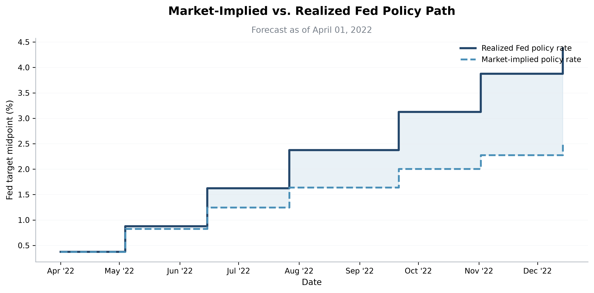
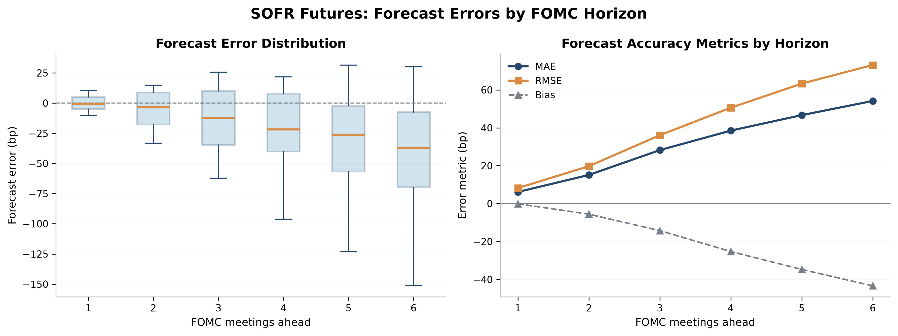
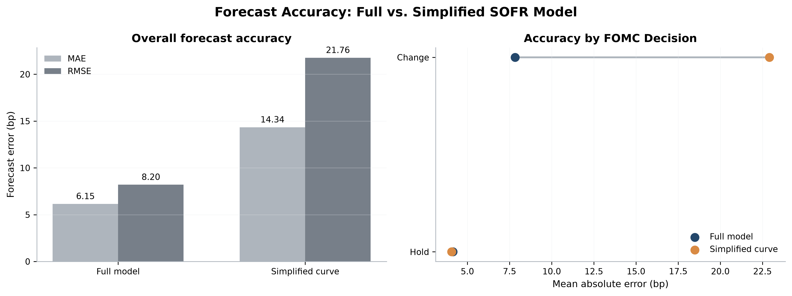
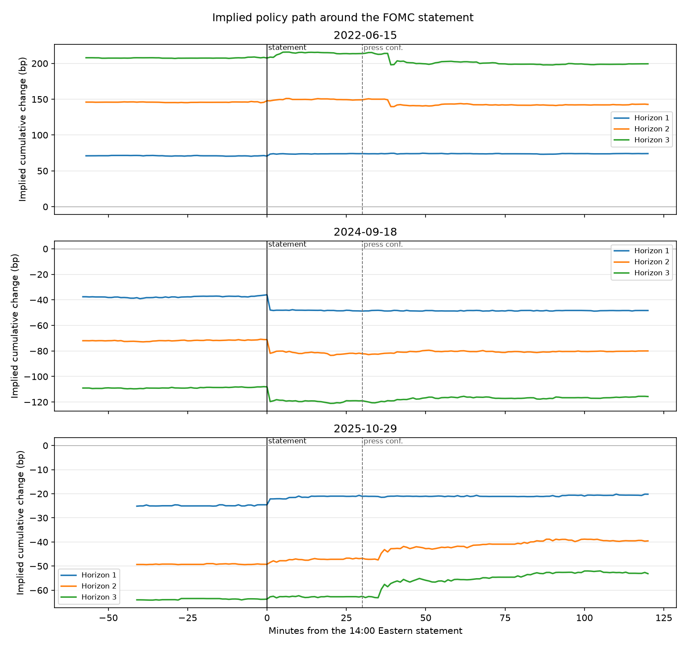

# Pricing the Fed with SOFR Futures

This project reads CME SOFR futures and recovers the federal-funds path the market was pricing before each FOMC meeting.

- At the next meeting the full model is 6.15 bp vs the simplified curve at 14.34 bp, on 44 monthly dates and 30 meetings. The curve ignores meeting dates.
- When the Fed changes the target, the full model is 9.78 bp vs the simplified curve at 25.05 bp (572 dates). When the Fed holds, the full model is 12.83 bp vs the simplified curve at 2.05 bp (594 dates).
- Six meetings out, mean absolute error is 54.15 bp and bias is -43.36 bp, so the futures path sat below the path the Fed delivered.
- On 25 of 33 days from 26 January 2022 through 28 January 2026, the front meeting moved less than 2 bp from 13:55 to 16:00 Eastern. The largest surprise was 18 September 2024, at -11.12 bp.

## The question

How much of the Fed's path is already in SOFR futures, and does a calendar-aware model beat a smooth curve?

## Data

The futures are Databento CME Globex `GLBX.MDP3`. SR1 and SR3 settlements come from the statistics schema, not from a daily close. One-minute `ohlcv-1m` bars cover 13:00 to 16:00 Eastern on announcement days. Overnight SOFR is the New York Fed fixing. The target range is FRED `DFEDTARL` and `DFEDTARU`. Meetings are the Federal Reserve's scheduled calendar. The settlement window is January 2022 through September 2026. The key is read from `~/.databento_api_key`, then `DATABENTO_API_KEY`. See `DATA.md` and `FED_RATE_DATA.md`.

## Method

An SR1 settles to average SOFR in a calendar month, and an SR3 to compounded SOFR between IMM dates. The price is 100 minus that rate. We fix the day's target-range midpoint, set the SOFR-minus-policy basis from up to 20 published fixings strictly before the observation date, and choose meeting moves by regularized least squares so model prices match the strip.

Error is the implied cumulative policy change minus the realized change, in basis points. A negative number means the futures priced a lower path than the Fed delivered.

The simplified curve bootstraps SR1 and puts no step on a meeting date. Monthly results use `sofr_pricing.fit_many` on the first futures date of each month: basis on 56 dates, a fit on 44, and six horizons. The daily table is a separate next-meeting SR1 bootstrap on 1,166 dates. See `docs/METHODOLOGY.md`, `FORECAST_EVAL.md`, `CURVE_COMPARE.md`, `final_visualizations/VISUALIZATIONS.md`, and `INTRADAY.md`.

## Figures

On 1 April 2022 the next meeting was +45.13 bp implied against +50 bp realized, and six meetings out it was +214.82 bp against +400 bp.



Absolute error rises from 6.15 bp at the next meeting to 54.15 bp at six, and direction is right on 43 of 44 dates under a 12.5 bp line.



The right panel splits the same 44 monthly dates into changes and holds, and it is not the daily hold gap.



| Horizon | N | Meetings | Bias (bp) | MAE (bp) | RMSE (bp) |
| --- | ---: | ---: | ---: | ---: | ---: |
| 1 | 44 | 30 | -0.09 | 6.15 | 8.20 |
| 2 | 44 | 30 | -5.57 | 15.12 | 19.75 |
| 3 | 44 | 30 | -14.27 | 28.24 | 36.09 |
| 4 | 44 | 30 | -25.27 | 38.51 | 50.59 |
| 5 | 44 | 30 | -34.74 | 46.68 | 63.31 |
| 6 | 44 | 30 | -43.36 | 54.15 | 73.11 |

| Daily next meeting | N | Full model (bp) | Simplified curve (bp) |
| --- | ---: | ---: | ---: |
| All dates, mean absolute error | 1166 | 11.34 | 13.33 |
| All dates, bias | 1166 | 0.13 | -6.58 |
| All dates, RMSE | 1166 | 20.77 | 20.57 |
| Target changed, mean absolute error | 572 | 9.78 | 25.05 |
| Target held, mean absolute error | 594 | 12.83 | 2.05 |

| Monthly next meeting | Full model (bp) | Simplified curve (bp) |
| --- | ---: | ---: |
| Bias | -0.09 | -7.06 |
| RMSE | 8.20 | 21.76 |

On 15 June 2022 the book was already +70.37 bp at 13:55, before a 75 bp hike, and the afternoon added +3.77 bp. On 29 October 2025 horizons 2 and 3 ended +9.77 bp and +10.44 bp versus 13:55.

18 September 2024 moved from -37.19 bp at 13:55 to -48.31 bp at 16:00, a change of -11.12 bp, on a degraded print (11 contracts, pricing error 0.33 bp).



## Limits

Futures prices include risk premia, so an implied move averages over outcomes. A wrong basis falls on the nearest meeting. The fixing calendar is weekdays only. Four afternoons have 7 meetings and rank 6, so the path chart omits them. 17 September 2025 is also degraded and moved +1.45 bp. Five 2026 statements fall after 16 September 2026, the last published meeting.

## Who built it

Maisha Miah built the Databento settlement pipeline (issue 1). Ivy Chan built the FOMC calendar, realized rates, and futures alignment (issues 2 and 14) and the final figures (issue 7). Theo Li built the SR1 and SR3 pricing framework (issue 3) and the Fed-path estimator (issue 4). Sankalp Yadav built the forecast scorecard (issue 5), the full-versus-simplified comparison (issue 6), and the intraday announcement study (issue 8). The original plan is in `PLANNING.md`.

## What is left

Score the daily bootstrap past the next meeting, put its step on the pricing code's next business day, add a holiday calendar, and extend the meeting list past 16 September 2026.

## How to run

Use Python 3.12 or newer. Run the commands from the repository root, after installing the dependencies.

```bash
python -m pip install -r requirements.txt
```

The Databento key is a single line in `~/.databento_api_key`, mode 600. `sofr_data/config.py` reads that file first and then the `DATABENTO_API_KEY` environment variable. Do not commit the key. Raw and processed market files under `data/` are gitignored.

Price every Databento pull before downloading, and stop if the quote is above 5 dollars. Cached chunks are not requested again. On this sample, with the caches already present, both quotes printed $0.0000.

```bash
python scripts/fetch_sofr_futures.py --dry-run
python scripts/fetch_sofr_futures.py
python -m scripts.fetch_rate_data
python scripts/fetch_intraday_sofr.py --dry-run
python scripts/fetch_intraday_sofr.py
```

The settlement command prints `Total estimated cost` and asks `Proceed with the pull? [y/N]`. Answer n when that total is above 5 dollars. Do not pass `--yes`. That flag skips the question and downloads anyway. The intraday command stops on its own when the quote is above 5 dollars.

`fetch_sofr_futures.py` writes `data/processed/sofr_futures_settlements.parquet`. `fetch_rate_data` writes `data/processed/sofr_daily.csv`, `data/processed/effr_daily.csv`, and `data/processed/fomc_meetings.csv`. `fetch_intraday_sofr.py` writes `data/processed/sofr_intraday_ohlcv_1m.parquet`.

The monthly horizon table, the monthly comparison, and the three figures in `docs/figures/` come from the commands below. `figures/` is gitignored, so the plot command writes `figures/historical/`. The README embeds the copies committed at `docs/figures/01_fed_paths.png`, `docs/figures/02_forecast_errors_by_horizon.png`, and `docs/figures/03_model_comparison.png`.

```bash
python -m scripts.prepare_historical_forecasts \
  --futures data/processed/sofr_futures_settlements.parquet \
  --sofr data/processed/sofr_daily.csv \
  --decisions data/processed/fomc_meetings.csv \
  --output-dir data/processed/visualizations
python -m scripts.prepare_visualization_inputs \
  --implied data/processed/visualizations/implied_forecasts.csv \
  --decisions data/processed/fomc_meetings.csv \
  --output-dir data/processed/visualizations
python -m scripts.prepare_historical_comparison
python -m scripts.generate_final_figures \
  --errors data/processed/visualizations/forecast_errors.csv \
  --decisions data/processed/fomc_meetings.csv \
  --comparison data/processed/visualizations/model_comparison.csv \
  --obs-date 2022-04-01 \
  --output-dir figures/historical
```

The horizon table is `figures/historical/forecast_accuracy_by_horizon_formatted.csv`. The monthly full-versus-simplified table is `figures/historical/model_comparison_summary_formatted.csv`.

The daily table is the printout of:

```bash
python -m scripts.run_curve_compare_real
```

The announcement figure is already at the path the study writes. Regenerate it with:

```bash
python scripts/run_intraday_demo.py --real --out reports/intraday/real
```

That rewrites `reports/intraday/real/repricing_paths.png` and the summary tables beside it, including `reports/intraday/real/snapshot_changes.csv`.

These four commands need no Databento key and no download. The synthetic intraday charts are a planted jump. Their titles say so, and they are not the historical numbers above.

```bash
python -m scripts.run_forecast_eval_demo
python -m scripts.run_curve_compare_demo
python scripts/run_intraday_demo.py --out reports/intraday
python -m pytest -q
```
